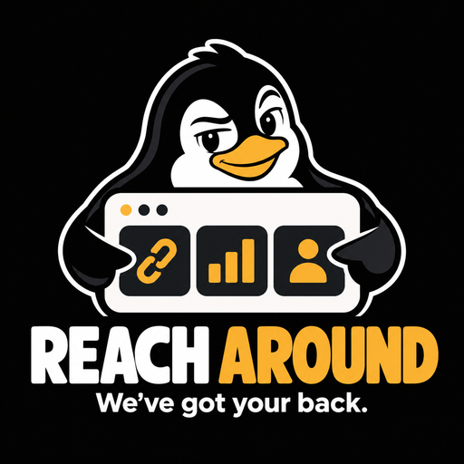

<p align="center">
  
</p>

# Reach Around

**Reach Around. We've got your back.**

> ## ⚠️ Alpha: early code, expect breaking changes
>
> Reach Around is **alpha**. The first release (`v0.1.0`) is a container image that builds a static link page from a config file. There is no stable configuration format and no upgrade path between `0.x` releases. Interfaces and file layouts will change without notice, and some platform behavior described in the research notes is unverified. Do not depend on it yet. This repository is private while that is true.

An open-source (Apache-2.0) single pane for creator analytics: one place for your link page, your media kit and your numbers across every platform you publish on, built to be self-hosted with your own API keys. It is meant to replace Beacons.ai for creators, close to 1:1, and then go further.

## What it is meant to do

- A fast, static link page (tabs, collapsible sections, phone and desktop layouts) with click tracking.
- A media kit that stays current on its own, with an email gate for partners and per-visitor tracking. The maintainer generates a private, complete PDF for offline use.
- Unified follower and performance numbers across the platforms you use, with a daily history, including ones other tools skip (Bluesky, Mastodon, Kick, Discord, Matrix).
- Optional Grafana, in a lab or in the cloud, and metric exports on demand, including an executive summary.
- Static to the visitor, with one small write-only Cloudflare Worker for the gate and click logging, to keep the attack surface small.

## Status

| Piece | State |
|---|---|
| Platform API research (16 platforms) | Merged as drafts with an independent review: [docs/research](docs/research/README.md) |
| Design spec | In progress: [docs/superpowers/specs](docs/superpowers/specs/) |
| Plan and roadmap | Drafts: [docs/superpowers/plans](docs/superpowers/plans/) |
| Code | Early alpha: config loader, static link page builder, container image |

The work is tracked on a GitHub Project board run with [Scrum Around and Find Out](https://github.com/ChiefGyk3D/scrum-around-and-find-out). Every task has an issue and a card before work starts.

## Run it with Docker or Podman

The image is an OCI image built from the `Containerfile`. It runs as a non-root user, works rootless, and needs no socket. Docker and Podman use the same commands. Build it, then build the example site (the output directory must be writable by uid 10001):

```sh
podman build -f Containerfile -t reach-around:local .     # or: docker build ...
mkdir -p out && chmod 0777 out
podman run --rm --read-only --cap-drop ALL \
  --security-opt no-new-privileges:true --tmpfs /tmp \
  -v ./examples/instance:/config:ro -v ./out:/out \
  reach-around:local build --config /config/site.yaml --out /out \
    --manifest /tmp/manifest.json --assets-inventory /tmp/assets.json
```

Replace the example mount with your own instance directory. Once `v0.1.0` is published the image is `ghcr.io/chiefgyk3d/reach-around:0.1.0` (pull it by digest, and sign-in is needed while the repository is private). See [docs/containers.md](docs/containers.md), [docs/releasing.md](docs/releasing.md) and the [changelog](CHANGELOG.md).

## Documentation

- [docs/deploy.md](docs/deploy.md): deploying the site and click Worker to Cloudflare (Pages or Worker, production branch, token type, Doppler, route by hand, troubleshooting)
- [docs/instance-repos.md](docs/instance-repos.md): keep your own page in a private repository that pins this project's release ([template](examples/instance-repo/))
- [docs/examples/deploy-private.sh](docs/examples/deploy-private.sh): a sanitized private deploy script for a real instance
- [docs/releasing.md](docs/releasing.md): cutting and verifying a release
- [docs/containers.md](docs/containers.md): running the container image
- [docs/config.md](docs/config.md) and [docs/customizing.md](docs/customizing.md): the site config and how to change the page
- [docs/preview.md](docs/preview.md): the local preview server

## License

Apache-2.0. See [LICENSE](LICENSE).

---

## 💝 Support This Project

If you find Reach Around useful, consider supporting continued development.
Everything is also collected at **[support.chiefgyk3d.com](https://support.chiefgyk3d.com)**.

### Recurring Support

<div align="center">
<table>
  <tr>
    <td align="center" width="150">
      <a href="https://patreon.com/chiefgyk3d" title="Patreon">
        <br>
        <sub><b>Patreon</b></sub>
      </a>
    </td>
    <td align="center" width="150">
      <a href="https://streamelements.com/chiefgyk3d/tip" title="StreamElements">
        <br>
        <sub><b>StreamElements</b></sub>
      </a>
    </td>
    <td align="center" width="150">
      <a href="https://shop.chiefgyk3d.com/" title="Merch Store">
        <br>
        <sub><b>Merch Store</b></sub>
      </a>
    </td>
  </tr>
</table>
</div>

### Cryptocurrency Tips

<div align="center">
<table>
  <tr>
    <td>&nbsp;<b>Bitcoin</b><br><code>bc1qztdzcy2wyavj2tsuandu4p0tcklzttvdnzalla</code></td>
  </tr>
  <tr>
    <td>&nbsp;<b>Monero</b><br><code>84Y34QubRwQYK2HNviezeH9r6aRcPvgWmKtDkN3EwiuVbp6sNLhm9ffRgs6BA9X1n9jY7wEN16ZEpiEngZbecXseUrW8SeQ</code></td>
  </tr>
  <tr>
    <td>&nbsp;<b>Ethereum</b><br><code>0x554f18cfB684889c3A60219BDBE7b050C39335ED</code></td>
  </tr>
  <tr>
    <td>&nbsp;<b>Solana</b><br><code>5T8h3HbyvHgLxwXgchRYbHSqRjZyAr8J7uwjLN9Fh8Jh</code></td>
  </tr>
</table>
</div>

---

## 👤 Author & Socials

<div align="center">
<table>
  <tr>
    <td align="center" width="90"><a href="https://social.chiefgyk3d.com/@chiefgyk3d" title="Mastodon"><br><sub>Mastodon</sub></a></td>
    <td align="center" width="90"><a href="https://bsky.app/profile/chiefgyk3d.com" title="Bluesky"><br><sub>Bluesky</sub></a></td>
    <td align="center" width="90"><a href="https://twitch.tv/chiefgyk3d" title="Twitch"><br><sub>Twitch</sub></a></td>
    <td align="center" width="90"><a href="https://www.youtube.com/channel/UCvFY4KyqVBuYd7JAl3NRyiQ" title="YouTube"><br><sub>YouTube</sub></a></td>
    <td align="center" width="90"><a href="https://kick.com/chiefgyk3d" title="Kick"><br><sub>Kick</sub></a></td>
    <td align="center" width="90"><a href="https://www.tiktok.com/@chiefgyk3d" title="TikTok"><br><sub>TikTok</sub></a></td>
    <td align="center" width="90"><a href="https://www.instagram.com/chiefgyk3d" title="Instagram"><br><sub>Instagram</sub></a></td>
    <td align="center" width="90"><a href="https://www.threads.net/@chiefgyk3d" title="Threads"><br><sub>Threads</sub></a></td>
    <td align="center" width="90"><a href="https://discord.chiefgyk3d.com" title="Discord"><br><sub>Discord</sub></a></td>
    <td align="center" width="90"><a href="https://matrix-invite.chiefgyk3d.com" title="Matrix"><br><sub>Matrix</sub></a></td>
  </tr>
</table>
</div>

<div align="center"><sub>Made with ❤️ by <a href="https://github.com/ChiefGyk3D">ChiefGyk3D</a></sub></div>
