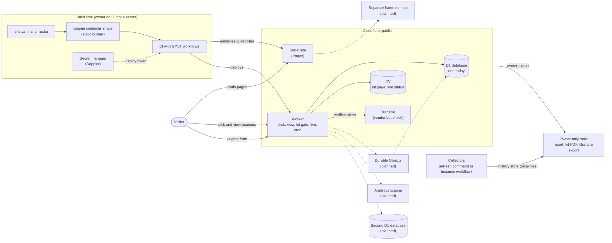

<!-- SPDX-License-Identifier: Apache-2.0 -->
# Diagram 1: Architecture overview

What runs where, and what is public, gated or owner-only. This shows the code
as it is today. Planned parts are drawn dashed and labeled "planned"; they are
not built.

Rendering note: the source uses no custom colors, only the renderer's own
theme, so it works on a dark background. Use the renderer's dark theme.

## Text description

The diagram has three groups and a set of arrows between them.

Build time. The owner's `site.yaml` and media go into the engine, a container
image with the static builder. CI calls the shared GYST workflows, which build
the site and deploy it. The secret manager supplies the deploy token to CI. None
of this is a running server.

Cloudflare, public. The built static site is served from Pages. One Worker
handles the click beacon, the page-view beacon, the media kit gate, the live
status route and the hourly scheduled jobs. It reads and writes one D1 database,
reads and writes KV (the gated kit page and the live status), and checks the
Turnstile token with Turnstile, a vendor service.

People and owner tools. A visitor reads pages from the static site and sends
beacons and the gate form to the Worker. Collectors, which the owner runs, write
to a local history store. Owner-only tools (the report, the kit PDF, the Grafana
export) read that store and an export of D1. They run on the owner's machine.

Planned, dashed, not built: Durable Objects between the Worker and D1,
Analytics Engine for daily counters, a second D1 database, and a separate domain
for the Turnstile helper frame.

Visibility. Everything under "Cloudflare, public" answers anyone who can reach
it, except the gated kit page, which the Worker serves only with an unlock
cookie. Owner-only tools never run on Cloudflare.
