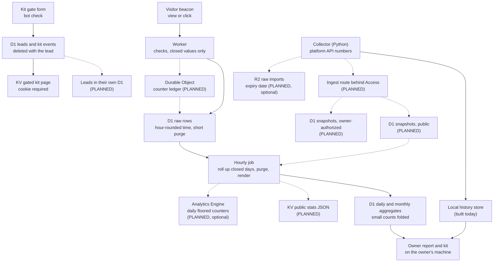

<!-- SPDX-License-Identifier: Apache-2.0 -->
# Diagram 2: Data flow

Where data goes after a visit, a kit request or a collector run, and where
retention, rounding and floors apply. Dashed lines and boxes labeled PLANNED are
not built on main. This is a public-level view: no limits or thresholds are shown.

Rendering note: no custom colors; use the renderer's dark theme.

## Text description

Read in three lanes.

**Lane 1, views and clicks.** A visitor beacon reaches the Worker. The Worker
checks it and keeps only closed values. Today it writes a raw row to D1 with the
time rounded to the hour, in one atomic batch with the budget counters. Planned:
a Durable Object counter ledger buffers the hot counters before they reach D1.
The hourly job rolls closed days into daily and monthly aggregates, folds small
counts together, and purges raw rows after the short retention window (7 days by
default, up to 90 at most). Planned: the same job renders public stats JSON into
KV and, if the owner turns it on, writes a few daily floored counters to
Analytics Engine. The owner's report reads the aggregates.

**Lane 2, the kit gate.** A visitor submits the kit form after a bot check. The
lead and its kit events go to D1. Kit events are deleted when the lead is
deleted. The gated kit page is served from its own KV namespace, only with the
unlock cookie. Planned: leads move to their own D1 database so an analytics
credential cannot reach them.

**Lane 3, collectors.** Python collectors read platform APIs into a local history
store, and the owner's report and kit read that store. Planned: collectors also
write through an ingest route behind Cloudflare Access into two D1 databases,
one public and one owner-authorized, and large raw files go to a private R2
bucket with an expiry date. The hourly job reads only the public database to
render public JSON, so the public side has no binding to owner data.

Rounding to the hour, the short purge, and the folding of small counts are
applied in lane 1. The kit lane keeps kit events only as long as the lead. The
collector lane's owner data expires by date.
