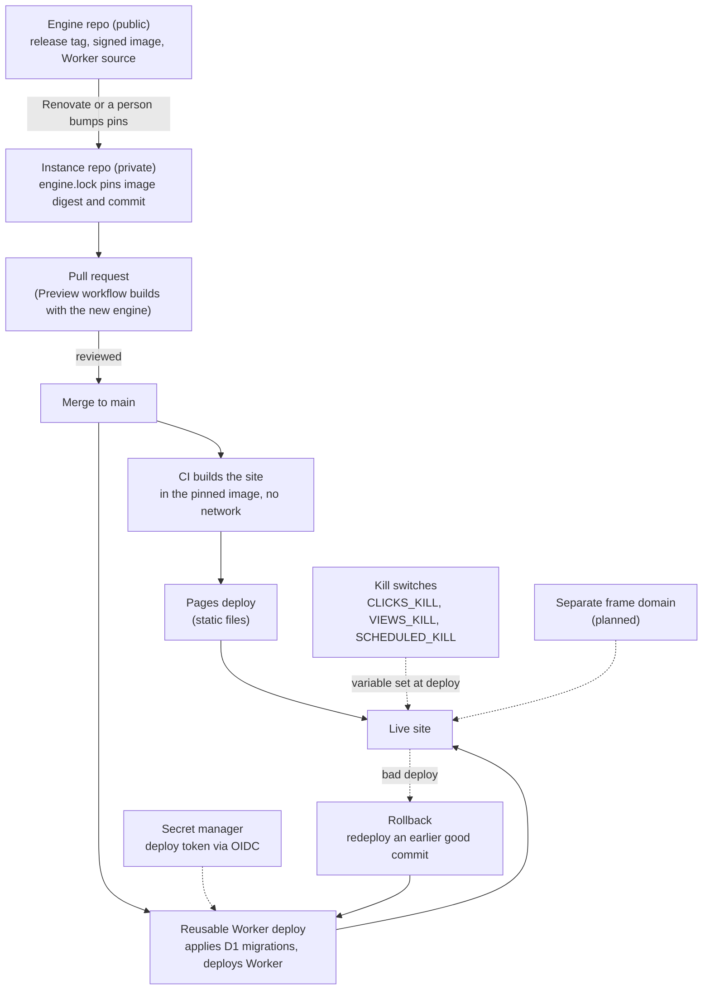

<!-- SPDX-License-Identifier: Apache-2.0 -->
# Diagram 3: Deployment

How a change moves from an owner's instance repository to the live site. This
is today's flow. The separate frame domain is planned and drawn dashed.

Rendering note: no custom colors; use the renderer's dark theme.

## Text description

Read top to bottom. The engine repository publishes a release: a signed
container image and the Worker source. The owner's private instance repository
holds `engine.lock`, which pins the image by digest and the Worker source by
commit. A pull request that moves the pins runs the Preview workflow, which
builds the site with the new engine. After review the pull request is merged to
main.

On main, CI builds the static site inside the pinned image with no network, then
publishes the files to Pages. In parallel, the reusable Worker deploy workflow
applies D1 migrations and deploys the Worker. It gets its Cloudflare token from
the secret manager over GitHub OIDC; no GitHub secret is read. Both deploys end
at the live site.

The three kill switches are Worker variables set at deploy. A bad deploy is
rolled back by redeploying an earlier good commit. The separate frame domain for
the Turnstile helper is planned and not part of this flow yet.
