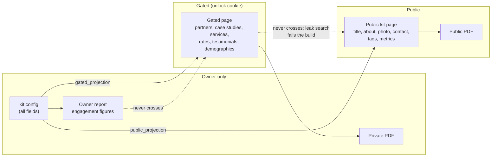

<!-- SPDX-License-Identifier: Apache-2.0 -->
# Diagram 4: The wall and visibility levels

Which kit content is public, gated or owner-only, and what crosses each line.
The rule comes from the display policy table in `reach_around/config/kit.py`,
described in [docs/kit.md](../../kit.md#the-wall-between-the-two).

Rendering note: no custom colors; use the renderer's dark theme.

Text description of this diagram, for readers who cannot see it.

Three levels, from most to least restricted.

Owner-only: the full kit config, the owner report (which holds the engagement
figures) and the private PDF. These never run on Cloudflare.

Gated: the gated kit page, built from the gated projection of the config. It
holds partners, case studies, services, rates, testimonials and demographics. The
Worker serves it from KV only to a visitor with a valid unlock cookie, which the
gate form (bot check, then a stored lead) issues.

Public: the public kit page and the public PDF, built from the public
projection: title, about, photo, contact, tags and metrics.

What crosses: the build renders each page from its own projection, so a
template cannot reach a field of the other level. The pages go to two separate
directories, checked by filesystem identity. As a second layer the build searches
every public file for each gated value and fails, naming the field, if it finds
one. Engagement figures are owner-report-only and appear on no page. Imported
history is gated unless the owner sets it public.
